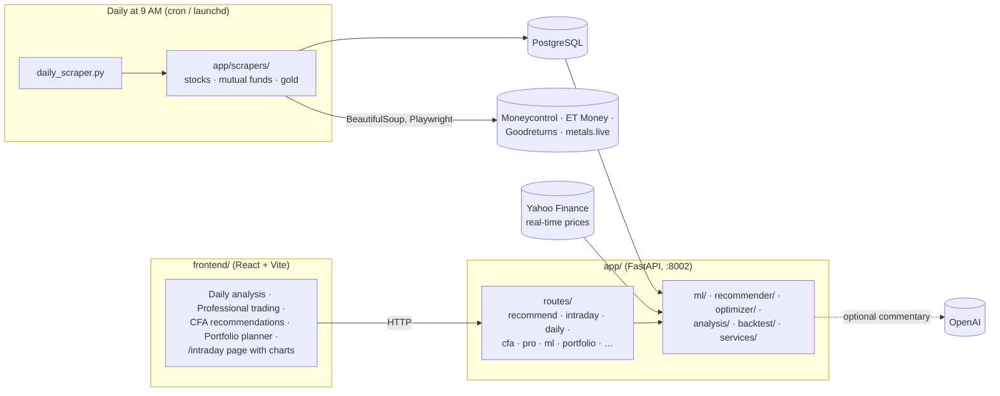

# Investor Recommendation System

Recommends where to put money across three Indian asset classes: **stocks**, **mutual funds** and **gold**. Every morning, scrapers collect prices and fund data into PostgreSQL. Machine-learning models (Random Forest + XGBoost), technical indicators and portfolio optimisation then score the opportunities. A React dashboard shows daily market scans, CFA-style investment picks, a budget-based portfolio planner, and intraday buy/sell signals with entry, exit, stop-loss and risk/reward on price charts.

> Personal project for learning. Not investment advice.

## How it fits together



| Part | Where | What it does |
|---|---|---|
| Dashboard | `frontend/src/` | The home page has tabs for daily analysis (`DailyAnalysis.tsx`), small-capital professional trading (`ProfessionalTrading.tsx`), CFA-style picks (`CFARecommendations.tsx`) and a budget-based portfolio planner (`App.tsx`). The `/intraday` page (`IntradayTrading.tsx`) shows intraday signals on Chart.js price charts with buy and sell markers (`StockChart.tsx`). |
| API | `app/main.py`, `app/routes/` | FastAPI app with one router per feature, plus endpoints to trigger scraping by hand. |
| ML | `app/ml/` | `predictor.py` trains Random Forest and XGBoost regressors (and a voting ensemble) per asset type; `technical_analysis.py` computes the indicators. Trained models are saved in `models/`. |
| Recommender | `app/recommender/`, `app/optimizer/` | Scores and ranks assets, splits a budget across them, and optimises a portfolio for the best Sharpe ratio. |
| Analysis | `app/analysis/`, `app/backtest/` | Sector analysis and backtests. |
| Services | `app/services/` | Data access for stocks, funds and gold, and optional OpenAI-written analysis. |
| Data collection | `app/scrapers/`, `daily_scraper.py`, `setup_daily_scraper.sh` | Scrapers that write to Postgres. The setup script installs a 9 AM cron job (or a macOS launchd agent). |
| Utilities | `app/utils/` | Indicator maths, NSE and mutual-fund fetchers, real-time prices, historical returns. |

## API overview

Full interactive docs at http://localhost:8002/docs once the server is running.

| Prefix | What's there |
|---|---|
| `/recommend` | Top picks overall and per asset class, sector views, budget allocation, optimised portfolio, combined and human-readable output |
| `/intraday` | Intraday buy/sell recommendations and chart data with signals for a symbol |
| `/daily` | Daily signals, a market scanner and a position-size calculator |
| `/cfa` | CFA-style recommendations, single-stock deep dives, real-time and sector views |
| `/pro` | Enhanced signals for small-capital trading |
| `/ml` | Train a model per asset type, predict, and ML-based recommendations |
| `/realtime` | Real-time recommendations and sector analysis from Yahoo Finance |
| `/api/portfolio` | Predict an investment recommendation from inputs |
| `/stocks`, `/mutual-funds`, `/gold` | Latest scraped data and status |
| `/backtest` | Run and check backtests |
| `/scrape/*` | Trigger scraping for stocks, funds, gold or all, and check status |

## Running it

**1. Database.** Start PostgreSQL locally and set the connection string in `app/db.py` (it defaults to a local `postgres` database).

**2. Backend:**

```bash
python -m venv venv && source venv/bin/activate
pip install -r requirements.txt
playwright install chromium          # needed by some scrapers
python start_server.py               # http://localhost:8002, docs at /docs
```

**3. Load data** (first run, then daily):

```bash
python daily_scraper.py              # one run now
./setup_daily_scraper.sh             # schedule it for 9 AM every day
```

**4. Dashboard:**

```bash
cd frontend
npm install
npm run dev
```

The dashboard expects the API at `http://localhost:8002`.

## Helpful scripts

| Script | Does |
|---|---|
| `run_recommendations.py` | Print recommendations from the command line |
| `run_predictor_demo.py` | Train and run the ML predictor on sample data |
| `check_data_status.py` | Show how fresh the scraped data is |
| `monitor_api.py` | Poll the API's health |
| `test_*.py`, `test_api.html` | Ad-hoc checks for the recommender, Yahoo data and API |

## Known issues

- The database URL, including its password, is written into `app/db.py`. Move it to an environment variable.
- The API has no sign-in; keep it on your own machine.
- There are leftover backup files (`app/main.py.backup`, `frontend/src/App_backup.tsx`, `temp_working_app.tsx`) and two files whose names start with `In ` in `app/scrapers/`.

## Tech stack

Python · FastAPI · SQLAlchemy · PostgreSQL · pandas · scikit-learn · XGBoost · yfinance · BeautifulSoup · Playwright · OpenAI (optional) · React · TypeScript · Vite · React Router · Tailwind CSS · Chart.js
